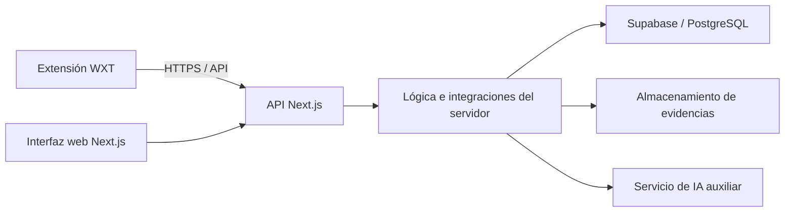

# Arquitectura de DarkShield

> Estado: arquitectura inicial del 9 de noviembre, con preparación transversal de Supabase y CI del 10 de noviembre de 2026. No se han implementado historias de usuario.

## Visión general

DarkShield será una plataforma colaborativa para consultar y reportar posibles _dark patterns_ en páginas web. Los usuarios podrán aportar evidencias y valorar reportes; la IA ayudará a analizar y estructurar esa información, **sin detectar autónomamente los patrones ni decidir por sí sola la validez de los reportes**.

La solución prevista conserva los componentes lógicos del ConOps: plataforma web, extensión del navegador, servidor, persistencia y apoyo de IA. Para el arranque se ha elegido una estructura sencilla: **dos aplicaciones dentro de un único repositorio** y un servicio gestionado de datos.

| Componente                   | Tecnología elegida                       | Función                                                                 |
| ---------------------------- | ---------------------------------------- | ----------------------------------------------------------------------- |
| Web y servidor HTTP (`web/`) | Next.js, React y TypeScript              | Interfaz web, futuros endpoints y lógica del servidor                   |
| Extensión (`extension/`)     | WXT, React, TypeScript y Manifest V3     | Cliente de navegador; actualmente solo dispone del popup inicial        |
| Persistencia (`supabase/`)   | Supabase / PostgreSQL y Supabase Auth    | CLI local y SDK preparados; tablas, RLS y acceso de usuarios pendientes |
| IA auxiliar                  | Sin implementación ni proveedor decidido | Análisis y estructuración de reportes cuando se aborden sus HU          |

Esta separación **no implica dos microservicios**: la extensión es un cliente instalado en el navegador y la web reúne la interfaz y el backend en una misma aplicación. Supabase es una dependencia externa gestionada. Las razones y alternativas de las elecciones están en los [registros de decisiones](#decisiones-arquitectónicas).

## Diagrama de componentes

El siguiente diagrama refleja las **comunicaciones previstas**, no conexiones ya operativas:

### Responsabilidades

- **`web/src/app/`**: páginas, layouts y futuros _Route Handlers_ en `web/src/app/api/`. Las operaciones compartidas por web y extensión deberán tener un contrato HTTP claro.
- **`web/src/server/`**: contiene la factoría Supabase marcada con `server-only`; albergará autorización y reglas del dominio. El cliente no debe ser la autoridad sobre roles, permisos, credibilidad o confianza.
- **`web/src/lib/supabase/`**: validación compartida y factoría de navegador marcada con `client-only`. Se valida al crear cada cliente, sin instancias globales ni acceso a red en la importación. Ambas factorías usan únicamente la clave publicable y desactivan persistencia, renovación y detección de sesiones en URL.
- **`extension/src/entrypoints/`**: hoy contiene el popup. Un _background/service worker_ y los permisos necesarios se estudiarán cuando se implementen HU-17 o HU-03. No existen actualmente consultas ni alertas reales.
- **`supabase/migrations/`**: carpeta preparada para versionar cambios de esquema y políticas de acceso. Todavía no hay tablas ni políticas.

Cuando ambos clientes necesiten reutilizar un contrato, se podrá incorporar `packages/contracts/` para los tipos o esquemas acordados. **No se crea todavía**: las entidades y formatos de intercambio deben surgir de las tareas de diseño, y TypeScript no sustituye la validación de datos recibidos por HTTP.

## Límites de integración y seguridad

- El servidor concentrará las operaciones de negocio que requieran autorización, cálculo de confianza/credibilidad, moderación, control de abuso o coordinación con la IA.
- Supabase Auth está adoptado. HU-11 resolverá sesiones en web y extensión, cookies SSR, verificación de identidad y renovación. No hay proxy de autenticación ni rutas protegidas. También siguen pendientes CORS, contratos HTTP, permisos de origen, acceso a evidencias y políticas RLS.
- No se colocarán claves privilegiadas de Supabase ni secretos de IA en el navegador, la extensión o variables expuestas al cliente. Las comprobaciones de permisos se harán en el servidor y, donde proceda, también en la base de datos.
- La extensión no tiene actualmente `host_permissions` ni `content_scripts` en su versión de producción. Consultar la pestaña mediante una acción del usuario y observar la navegación en segundo plano presentan requisitos de permisos distintos; no se habilitará acceso global sin una necesidad justificada.
- Los reportes son **alegaciones que deben evaluarse**, no confirmaciones automáticas. La credibilidad cambiará con nueva evidencia y participación; la IA es apoyo a la comunidad y a la moderación.

## Decisiones arquitectónicas

La preparación utiliza `@supabase/supabase-js` sin estado. `@supabase/ssr` se
incorporará en HU-11 junto con el flujo completo de cookies de App Router: su
cliente de navegador persiste sesiones en cookies y no corresponde activarlo en
esta intervención. No se utilizan los antiguos Auth Helpers. Las factorías no
autentican peticiones ni ofrecen acceso autorizado a datos de usuario. Consultar
los [ejemplos y límites](development.md#clientes-supabase).

Las decisiones existentes se han extraído del antiguo `arquitectura.md` y separado por ámbito:

1. [ADR-001 — Repositorio único y TypeScript](adr/0001-repository-and-typescript.md).
2. [ADR-002 — Web y backend con Next.js](adr/0002-nextjs-web-and-backend.md).
3. [ADR-003 — Extensión con WXT y Manifest V3](adr/0003-wxt-browser-extension.md).
4. [ADR-004 — Persistencia con Supabase](adr/0004-supabase-persistence.md).

Son decisiones de arranque revisables; no implican que las HU correspondientes estén terminadas.

## Trabajo todavía no definido o implementado

Siguen pendientes el modelo de dominio y de datos, las migraciones, el acceso a evidencias, las políticas RLS, autenticación, sesiones, contratos API, cálculo de credibilidad, integración con IA, pruebas funcionales y permisos de navegador. Tampoco se han elegido un ORM, colas, servicio independiente de IA ni un sistema adicional de orquestación del monorepositorio: no existe aún una necesidad que los justifique.

El [diseño del dominio](domain-design.md) recoge expresamente lo que falta por definir; el [documento de desarrollo](development.md) conserva la organización del Sprint 1, los criterios de trabajo y las discrepancias entre fuentes. El [README](../README.md) contiene los comandos de instalación y arranque.
