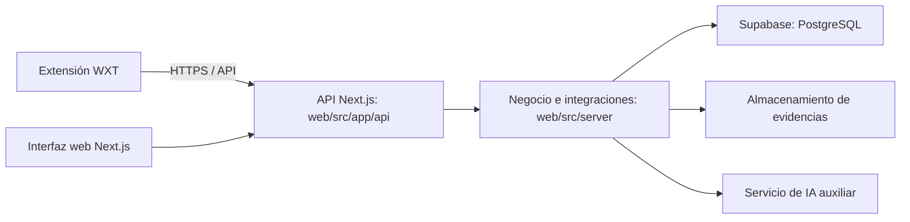

# ADR-001: arquitectura y esqueleto inicial de DarkShield

Fecha: 9 de noviembre de 2026. Estado: propuesta adoptada en este esqueleto,
revisable por el equipo. No modifica la asignación de tareas ni el alcance del Sprint.

## Decisión y motivos

Usar **TypeScript en las dos aplicaciones**, con **`web/` y `extension/` separados**
dentro del repositorio actual. npm workspaces coordina la instalación, las versiones
y los comandos, conservando un paquete y una compilación por aplicación.

La extensión se ejecuta en el navegador: TypeScript se compila a JavaScript y permite
utilizar sus APIs con tipos. Un segundo lenguaje añadiría herramientas y aprendizaje
sin una necesidad identificada. React en ambas interfaces reduce cambios de contexto;
no obliga a compartir los componentes visuales ni sus dependencias de servidor.

| Parte         | Elección                                                   | Motivo y límite                                                                                                             |
| ------------- | ---------------------------------------------------------- | --------------------------------------------------------------------------------------------------------------------------- |
| Web y backend | Next.js App Router, React y TypeScript                     | Páginas y API en una aplicación desplegable; evita mantener otro servidor para el primer sprint.                            |
| Extensión     | WXT, React, TypeScript, Manifest V3                        | Genera el manifest y empaqueta los puntos de entrada. Objetivo inicial Chrome/Edge, con posibilidad de ampliar navegadores. |
| Persistencia  | Supabase/PostgreSQL                                        | Decisión del equipo; migraciones SQL versionadas. Auth y Storage son propuestas para las HU correspondientes.               |
| Herramientas  | npm workspaces, TypeScript estricto, ESLint, Prettier y CI | Misma instalación y comprobaciones para los ocho integrantes, sin añadir un orquestador de monorepos.                       |

Las versiones concretas están fijadas en los `package.json` y el lockfile. Se usa
TypeScript 5.9.3 porque es compatible con el rango declarado por typescript-eslint;
actualizar a una versión mayor requiere comprobar conjuntamente lint y frameworks.

Se mantiene ESLint 9.39.5 por compatibilidad con `eslint-plugin-react`, dependencia
de la configuración oficial de Next.js que todavía declara ESLint 9 como máximo.
Esta rama de ESLint ha terminado su soporte: revisar su actualización cuando la
cadena de plugins admita ESLint 10, sin forzar dependencias incompatibles.

La auditoría inicial de npm informa de ocho avisos moderados en la cadena de
typescript-eslint/Next ESLint por `minimatch` (herramientas de desarrollo). La
corrección automática propone retroceder versiones mayores, por lo que no se aplica
`npm audit fix --force`. `npm audit --omit=dev` no informa de vulnerabilidades.
Revisar [GHSA-g3hv-75wg-m249](https://github.com/advisories/GHSA-g3hv-75wg-m249)
al actualizar las herramientas; estos resultados no son una garantía de seguridad.

Dos directorios no implican dos microservicios: la extensión es un cliente instalado
en el navegador; `web/` contiene el proceso servidor y la interfaz web. Supabase es
infraestructura gestionada externa. Los componentes lógicos del ConOps se conservan,
aunque frontend y servidor compartan proyecto y despliegue.

## Límites y comunicación previstos

Este diagrama representa la arquitectura futura, no conexiones implementadas:

- `web/src/app/`: presentación y rutas. Los futuros Route Handlers son la entrada
  HTTP para la extensión y las operaciones de la web.
- `web/src/server/`: reglas de autorización, negocio y acceso a servicios. Sus módulos
  se crearán por funcionalidad, con una frontera de servidor explícita. La interfaz
  no decide roles, permisos ni credibilidad por sí sola.
- `extension/src/entrypoints/`: popup inicial. Añadir un background/service worker
  al implementar HU-17 o HU-03, con permisos justificados por esas operaciones.
  `activeTab` sirve para interacciones iniciadas por el usuario; observar navegación
  de forma pasiva requiere un análisis distinto de permisos y privacidad.
- `supabase/migrations/`: evolución de tablas y políticas de acceso. No introducir
  SQL diferente en cada cliente ni credenciales privilegiadas en la extensión.
- Cuando exista el primer contrato consumido por ambos clientes, extraer los DTOs
  o esquemas acordados a `packages/contracts/`. Todavía no se crea un paquete vacío
  ni se fijan entidades antes de las tareas de diseño. Los tipos no validan datos en
  tiempo de ejecución: esa comprobación corresponde a los límites HTTP.

La autenticación podrá usar Supabase Auth y su integración de sesiones con Next.js.
La elección de cookies o tokens para cada cliente, CORS, los permisos de origen de
la extensión y los contratos HTTP se resolverán al implementar las HU relacionadas.
No se habilita acceso global a todas las páginas ni se inyectan content scripts.

## Alternativas consideradas

| Alternativa                                                                          | Evaluación                                                                                                                                                 |
| ------------------------------------------------------------------------------------ | ---------------------------------------------------------------------------------------------------------------------------------------------------------- |
| Una única aplicación que mezcle web y extensión                                      | Complica separar APIs del navegador, código de servidor, secretos, manifiesto y distribución. Compartir repositorio basta.                                 |
| Repositorios independientes                                                          | Posible en el futuro, pero ahora duplica configuración y dificulta coordinar cambios de contrato en un mismo PR.                                           |
| React/Vite más Express o Fastify                                                     | Válida si necesitáis backend desplegado de forma independiente. Añade otro arranque y configuración; Next.js cubre la necesidad inicial de interfaz y API. |
| JavaScript en la extensión                                                           | Funciona, pero pierde comprobaciones de tipos y la uniformidad pedida para el resto del proyecto.                                                          |
| Extensión manual con manifest y empaquetador propios                                 | Menos abstracción, pero el equipo tendría que mantener el empaquetado y la recarga. WXT concentra esa configuración.                                       |
| Supabase como única API de negocio desde todos los clientes                          | Puede servir para operaciones simples; las reglas de confianza, validación, abuso e IA justifican un servidor común según el ConOps.                       |
| Servicio independiente de IA, colas, ORM o monorepo con Nx/Turborepo desde el inicio | No hay aún carga, contratos ni operaciones que justifiquen añadirlos. Revisar si aparecen trabajos largos o requisitos de despliegue propios.              |

Next.js introduce sus convenciones de rutas y separación cliente/servidor; WXT añade
una dependencia de herramientas para la extensión. Son costes de aprendizaje que
se aceptan para reducir configuración propia. El backend web necesitará un runtime
de servidor, aunque la página inicial pueda generarse estáticamente.

## Revisión de las seis fuentes

Se revisaron los seis PDF completos del directorio `Fuentes` (279 páginas en total).
Los enlaces siguientes son relativos al repositorio y presuponen que `Fuentes`
permanece como directorio hermano. Los números son páginas físicas de cada PDF.

| Fuente                                                                                                                                                | Hallazgos que afectan a esta propuesta                                                                                                                                                                                                    |
| ----------------------------------------------------------------------------------------------------------------------------------------------------- | ----------------------------------------------------------------------------------------------------------------------------------------------------------------------------------------------------------------------------------------- |
| [Dark-Shield ConOps](../../Fuentes/Dark-Shield%20ConOps.pdf), 21 páginas; especialmente 7, 11-16 y 18-21                                              | Clientes web/extensión, servidor coordinador, persistencia e IA auxiliar. La extensión consulta información existente y no modifica las páginas. El idioma inicial es español; privacidad, permisos y trazabilidad condicionan el diseño. |
| [Historias de usuario](../../Fuentes/Historias%20de%20usuario.pdf), 23 páginas                                                                        | HU-01 a HU-23 detallan operaciones, permisos y pruebas. HU-17 consume una API del servidor; HU-03 exige investigar navegación y alertas; HU-12 requiere tolerar fallos de IA. No se deriva de ellas un escáner autónomo de páginas.       |
| [Soluciones prácticas 3, 4, 5 y 6](../../Fuentes/Soluciones%20prácticas%203,%204,%205%20y%206.pdf), 36 páginas; especialmente 5, 7-14 y 30-36         | Sprint 1 del 9 al 22 de noviembre: ocho HU, 85 h 55 min incluyendo control, capacidad de 93 h 30 min. HU-16 y HU-17 siguen en backlog. Diseño simple, revisión cruzada, TDD, cobertura y CI forman parte del proceso.                     |
| [Tema 0 - Presentación](../../Fuentes/Tema%200%20-%20Presentación.pdf), 22 páginas; especialmente 12-17                                               | Proyecto académico con fuerte componente de gestión y trabajo en equipo. Favorece un arranque pequeño, documentado y fácil de reproducir; no prescribe un framework.                                                                      |
| [Tema 1 - Introducción](../../Fuentes/Tema%201%20-%20Introducción.pdf), 76 páginas; especialmente 26-47 y 55-59                                       | Requisitos trazables, alternativas técnicas justificadas, ADR y deuda explícita. De ahí este registro y la separación entre estructura y funcionalidad.                                                                                   |
| [Tema 2 - Aspectos Transversales](../../Fuentes/Tema%202%20-%20Aspectos%20Transversales.pdf), 101 páginas; especialmente 14-19, 35-40, 49-60 y 85-100 | Riesgos de proveedores, secretos y dependencias; costes de operación, calidad y verificaciones continuas. Motiva versiones bloqueadas, configuración local excluida de Git y CI mínima.                                                   |

El ConOps clasifica la extensión como Should Have y excluye la detección autónoma,
la modificación de páginas y la validación definitiva por IA. Por tanto, el popup
vacío prepara el componente solicitado sin adelantar HU-17, HU-03 ni HU-22.

## Mapa del Sprint 1 y orden de integración

Las ubicaciones de esta tabla son orientaciones para crear los módulos cuando toque;
no contienen implementaciones ni modelos prediseñados.

| HU                                | Área futura                      | Coordinación inicial                                                                    |
| --------------------------------- | -------------------------------- | --------------------------------------------------------------------------------------- |
| HU-14: usuarios, roles y permisos | Servidor y migraciones           | Acordar identidad/perfil y permisos antes de HU-11 y HU-10.                             |
| HU-11: autenticación              | Web, servidor e integración Auth | Contrato de sesión y autorización antes de registrar reportes.                          |
| HU-05: crear reportes             | Web, API, servidor y migraciones | Acordar datos y errores de la API para desbloquear consulta, evidencias y valoraciones. |
| HU-06: evidencias                 | Web, servidor y almacenamiento   | Resolver almacenamiento, acceso y validación de archivos.                               |
| HU-10: confianza y permisos       | Web y servidor                   | Compartir reglas con HU-08; el cliente no puede alterar su nivel.                       |
| HU-01: consulta                   | Web, API y servidor              | Depende del modelo de reportes y su visibilidad.                                        |
| HU-08: validación/invalidación    | Web, servidor y migraciones      | Requiere identidad, reportes y permisos; considerar concurrencia.                       |
| HU-09: credibilidad               | Web y servidor                   | Acordar cálculo y representación a partir de HU-06 y HU-08.                             |

La cadena principal es HU-14 → HU-11 → HU-05, con HU-14 → HU-10 → HU-08
y HU-06/HU-08 → HU-09. Compartir sprint no elimina estas dependencias. Los contratos
pueden acordarse antes de que estén terminadas las implementaciones.

## Discrepancias y decisiones pendientes

1. El PDF de HU repite varias historias y bloques de tareas en páginas consecutivas.
   Se identifican por HU-xx, sin tratarlos como trabajo adicional.
2. HU-01 menciona acceso al detalle; P4 concreta su T6 como información resumida desde
   el listado, mientras HU-02 no entra en el sprint. Mantener explícita esa diferencia
   al aceptar HU-01, sin incorporar el detalle completo por accidente.
3. HU-09 T3 habla de un desplegable en el perfil; P4 lo concreta como credibilidad y
   explicación en el reporte. Usar la concreción del sprint al diseñar esa pantalla.
4. HU-03 incluye una tarea de alerta flotante, pero los criterios y el ConOps prohíben
   modificar la página externa. Resolver el diseño de la alerta en la interfaz del
   navegador antes de implementar inyección de elementos en páginas.
5. HU-18 y HU-19 contienen tareas de verificación de dominio que se solapan. Compartir
   ese mecanismo cuando se prioricen, sin duplicar modelos ni esfuerzo.
6. La simulación de ausencia de P6 (p. 35) usa asignaciones de usuarios, autenticación
   y datos distintas a la tabla de P4. Para el reparto real, tomar P4 como referencia
   y contrastar con el tablero vigente; el ejemplo no reasigna tareas.
7. P5 (p. 28) plantea decidir acciones según la cobertura; P6 (p. 36) propone paralizar
   nuevas funciones por debajo del 80 %. El equipo deberá armonizar esa regla al
   configurar las pruebas. Este esqueleto no interpreta CI verde como DoD cumplida.
8. El diagrama de bloques aparece como marcador en el ConOps (p. 14); no se presupone
   una arquitectura tecnológica ya aprobada que no está descrita en las fuentes.

## Supabase, límites y trabajo pospuesto

La elección de Supabase ya viene dada por el equipo. Auth puede evitar implementar
contraseñas propias y Storage puede alojar evidencias; ambos se deben configurar al
abordar las HU correspondientes. La credibilidad y confianza son reglas de DarkShield,
no funcionalidades que la base de datos resuelva automáticamente.

El plan Free permite comenzar sin coste, pero tiene límites de base de datos,
almacenamiento y transferencia, y contempla pausas por inactividad. Las evidencias
serán un punto a vigilar. Consultar el [plan vigente](https://supabase.com/pricing)
antes de dimensionar almacenamiento; este esqueleto no contrata ni crea servicios.

Pendiente para las HU: esquema relacional, migraciones, RLS, sesiones, autorización,
validación de entradas, límites de archivos, tests, cobertura y contratos compartidos.
También quedan pendientes los permisos de navegador y la integración HTTP de la
extensión. No se introduce una API ni datos simulados solo para aparentar integración.

No se añade todavía un framework de pruebas: debe configurarse con la primera HU
y sus casos reales, incluyendo pruebas de acceso denegado y las integraciones que
correspondan. La cobertura actual es **no disponible**, según el criterio de P5;
no se atribuye un 80 % a páginas vacías. CI comprueba solo la base técnica.

## Verificación inicial del esqueleto

Comprobado localmente con Node.js 24.15.0 y npm 12.2.1:

- Instalación de dependencias y generación del lockfile raíz.
- `npm run check`: formato, lint, tipos y compilación de ambas aplicaciones correctos.
- Servidor web de producción: respuesta HTTP 200, título DarkShield e idioma español.
- Paquete de extensión generado: Manifest V3, popup y ausencia de permisos,
  `host_permissions` y `content_scripts` de producción.
- `git diff --check`: sin errores de whitespace.

La extensión no se ha instalado manualmente en un navegador durante esta validación.
El workflow está preparado, pero no se ha ejecutado en GitHub. No se han probado
funciones de negocio ni conexiones con Supabase, porque todavía no existen.

## Documentación técnica consultada

- [Next.js: instalación y TypeScript](https://nextjs.org/docs/app/getting-started/installation).
- [Next.js: Route Handlers](https://nextjs.org/docs/app/getting-started/route-handlers).
- [WXT: instalación](https://wxt.dev/guide/installation.html),
  [React](https://wxt.dev/guide/essentials/frontend-frameworks.html) y
  [manifest](https://wxt.dev/guide/essentials/config/manifest.html).
- [Supabase: claves y separación de privilegios](https://supabase.com/docs/guides/api/api-keys)
  y [RLS](https://supabase.com/docs/guides/database/postgres/row-level-security).

Consulta realizada el 9 de noviembre de 2026. La recomendación de organización es
una decisión para este proyecto, basada en sus fuentes y alcance, no una obligación
impuesta por los frameworks.
